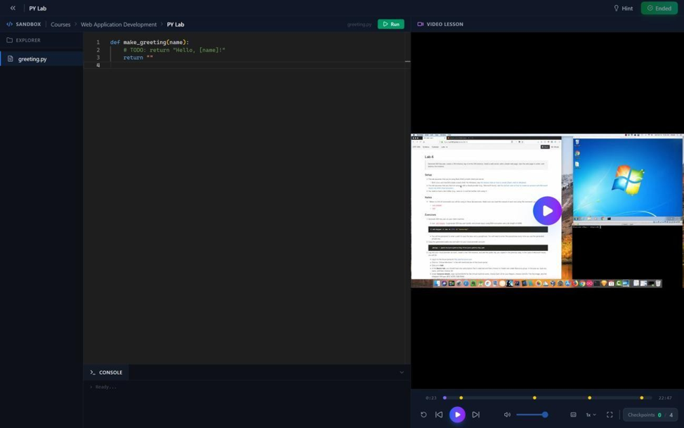
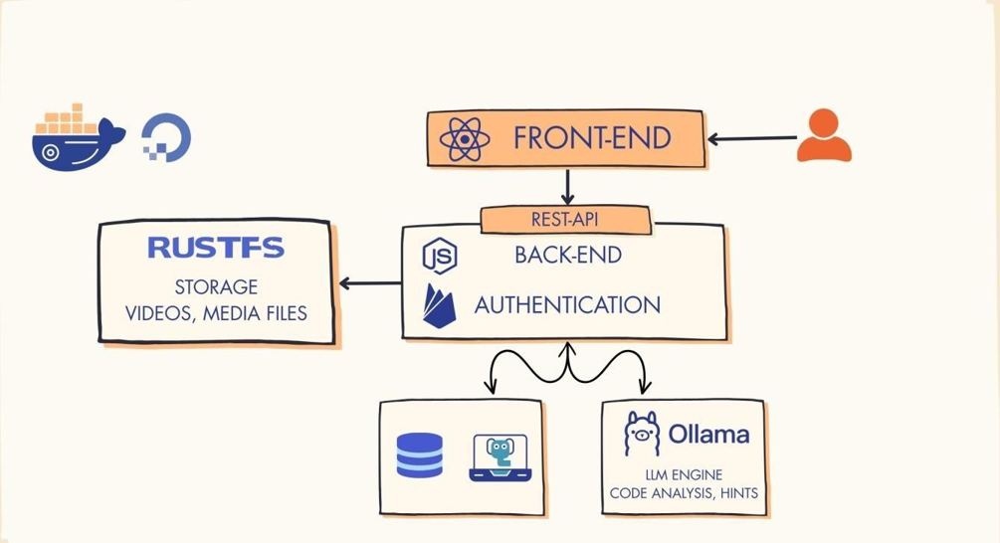

# IntelliTA

### AI-guided programming labs with immediate, context-specific feedback

IntelliTA is an intelligent learning platform designed to make programming labs more interactive, supportive, and scalable. Students solve structured coding activities in a browser-based workspace, run their code against instructor-defined tests, and context-specific feedback based on their code.

For instructors, IntelliTA brings course management, AI-assisted lab authoring, progress tracking, gamification, and GitHub-backed submissions into one platform. Instructors can upload video-based lab content, have it transcribed automatically, and generate quiz questions grounded in the transcript.




## Why IntelliTA?

Programming students often wait too long for help, receive feedback after they have moved on, or rely on generic AI answers that reveal a solution without supporting the learning process. At the same time, instructors and teaching assistants repeatedly address the same errors across large classes.

IntelliTA addresses this gap with a structured workflow:

1. An instructor creates a course, lab, and checkpoint-based activity.
2. For video activities, IntelliTA transcribes the uploaded content and helps the instructor generate questions from selected transcript segments.
3. A student writes code in a text editor or answers questions at configured video checkpoints.
4. IntelliTA executes code against the checkpoint's test in an isolated Piston sandbox.
5. The student receives an immediate pass/fail result.
6. If the test fails, the AI assistant uses the student's code, the relevant test, and its failure output to generate a targeted hint without exposing the solution.

## Key Features

### For students

- Browser-based coding workspace powered by Monaco Editor
- Structured labs with activities and incremental checkpoints
- Sandboxed code execution with immediate test results
- AI hints grounded in the current code and failing test
- Multi-turn assistant with guardrails that keep conversations focused on the lab
- Course enrollment through join codes and invitations
- Progress tracking, points, badges, leaderboards, and notifications
- GitHub-connected submissions and version-controlled work
- Multilingual and speech-to-text support
- Light and dark themes

### For instructors

- Role-based course and enrollment management
- Lab, activity, and checkpoint authoring
- Automatic transcription of uploaded video activities
- AI-generated quiz suggestions based on transcript segments
- Instructor-defined starter files and unit tests
- Student progress and submission monitoring
- GitHub organization and Classroom integration
- Automated feedback that reduces repetitive support requests

## What Makes the AI Different?

IntelliTA is designed as a teaching assistant, not a solution generator. When a student requests help, the platform can execute the checkpoint test and ground the prompt in:

- the student's current code;
- the instructor-defined test contract; and
- the resulting failure output.

This gives the model concrete context for a relevant conceptual hint. An off-topic classifier also prevents the lab assistant from becoming a general-purpose chatbot.

IntelliTA also supports AI-assisted content creation. After an instructor uploads a video activity, the local Whisper service extracts a timestamped transcript. The AI service can then use selected transcript segments to suggest relevant quiz questions, which the instructor can review and configure as checkpoints before students begin the lab.


## Architecture

IntelliTA uses independently containerized services orchestrated with Docker Compose.



| Layer | Technology | Responsibility |
| --- | --- | --- |
| Frontend | React, Vite, Tailwind CSS, Monaco Editor | User interface and in-browser coding experience |
| API | Node.js, Express, Sequelize | Application logic, courses, labs, users, and integrations |
| Database | PostgreSQL, pgAdmin | Persistent application data and database administration |
| AI service | Python, FastAPI, Ollama/Groq | Guarded chat, test-aware hints, and transcript-based quiz generation |
| Code execution | Piston | Isolated compilation and execution of student code |
| Object storage | RustFS / S3-compatible API | Uploaded lab files and resources |
| Authentication | Firebase Authentication | Identity and protected API access |
| Speech and transcription | Whisper | Video transcription and speech-to-text input |
| Localization | i18next, Azure Translator | Multilingual interface and content support |
| Observability | Sentry, Winston | Client/server monitoring and structured logs |
| Infrastructure | Docker Compose | Local orchestration of the complete platform |

## Running IntelliTA Locally

### Prerequisites

- [Git](https://git-scm.com/)
- [Docker](https://www.docker.com/) with Docker Compose
- Sufficient memory for the database, AI model, code sandbox, and application services
- NVIDIA Container Toolkit if the optional GPU reservations for Ollama and Whisper are enabled

### 1. Clone the repository

```bash
git clone https://github.com/UsableSystemsLab/intelliTA.git
cd intelliTA
```

### 2. Configure the environment

Copy the provided template:

```bash
cp example.env .env
```

On Windows PowerShell:

```powershell
Copy-Item example.env .env
```

Review `.env` and replace the example values. The main configuration groups are:

- PostgreSQL and pgAdmin
- Firebase client and Admin SDK configuration
- RustFS or external S3-compatible storage
- Ollama and optional Groq access
- Piston language runtimes
- Whisper model selection
- Azure Translator
- Sentry

Never commit `.env`, Firebase service-account credentials, access tokens, or production secrets.

### 3. Build and start the platform

```bash
docker compose up --build
```

The first build can take several minutes while Docker downloads images, installs the configured Piston runtimes, and prepares the AI services.

### 4. Open the application

With the default values from `example.env`:

| Service | URL |
| --- | --- |
| IntelliTA web application | <http://localhost:3000> |
| API health check | <http://localhost:4000/health> |
| AI service health check | <http://localhost:8000/health> |
| Whisper health check | <http://localhost:8001/health> |
| pgAdmin | <http://localhost:5050> |
| RustFS API | <http://localhost:9000> |
| RustFS console | <http://localhost:9001> |
| Ollama API | <http://localhost:11434> |

Ports can be changed through `.env`.

### 5. Stop the platform

```bash
docker compose down
```

Docker named volumes preserve the database, object storage, downloaded model data, and Whisper cache between runs.

To remove those volumes and reset local data:

```bash
docker compose down -v
```

> This reset is destructive and permanently removes data stored in the Compose volumes.

## Testing

The React frontend and Express API include Jest test suites.

```bash
cd react_app
npm test
```

```bash
cd api_server
npm test
```

Coverage commands are also available in both packages:

```bash
npm run test:coverage
```

The project report additionally documents end-to-end system testing across authentication, course management, enrollment, checkpoint execution, AI hints, guardrails, gamification, themes, and major desktop browsers.

## Repository Structure

```text
intelliTA/
├── react_app/          # React and Vite frontend
├── api_server/         # Node.js and Express API
├── llm/                # Ollama image and Python AI service
├── piston/             # Sandboxed code-execution service
├── whisper_server/     # Speech-to-text service
├── db_init_scripts/    # PostgreSQL initialization scripts
├── docker-compose.yml  # Development environment
└── docker-compose.prod.yml
```

## Team

IntelliTA was created as a CPIT 499 graduation project in the Department of Information Technology, Faculty of Computing and Information Technology, King Abdulaziz University.

- Mohanad Babgi
- Meshal Okairy
- Amer Bugshan

Supervised by **Dr. Khalid Alharbi**.

## License

This project is available under the [MIT License](LICENSE).
